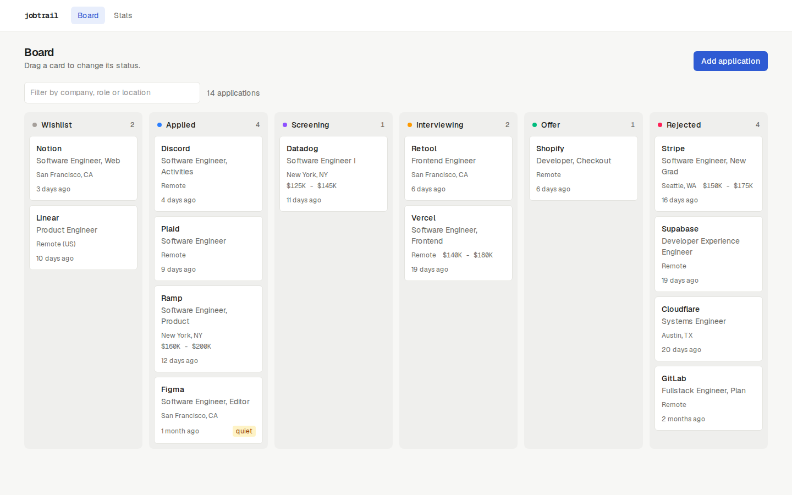
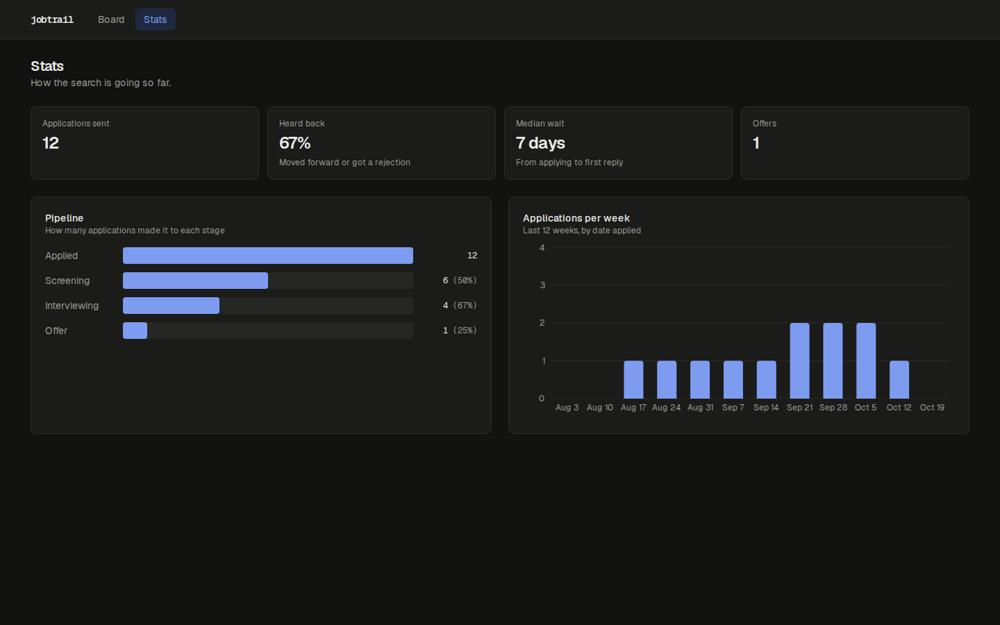

# jobtrail

[](https://github.com/peterlee1022/jobtrail/actions/workflows/ci.yml)

A small self-hosted tracker for job applications. Spreadsheets work fine until it gets hard to remember who has replied and who has gone quiet, so this puts everything on a board instead.



## What it does

- Kanban board with a column per stage (wishlist, applied, screening, interviewing, offer, rejected). Drag cards between columns to update them.
- Every status change gets logged, so each application has a timeline. You can add notes to it too (who you talked to, what they asked, etc).
- Cards that have been sitting in applied or screening for 3+ weeks get a "quiet" tag so you know who to follow up with.
- Stats page with the pipeline funnel, response rate, median time to hear back, and applications per week.
- Salary fields accept stuff like `120k` or `$150,000` because that's how people actually type it.



## Stack

- [Next.js 15](https://nextjs.org) with the App Router, React Server Components and Server Actions (no separate API layer)
- TypeScript, strict mode
- [Drizzle ORM](https://orm.drizzle.team) on SQLite via libsql. Swapping `DATABASE_URL` for a Turso URL works without code changes.
- [Zod](https://zod.dev) for validating form input on the server
- Tailwind CSS v4
- [dnd-kit](https://dndkit.com) for drag and drop, with optimistic updates through `useOptimistic`
- Recharts for the weekly chart
- Vitest for unit and integration tests, Playwright for end to end tests
- GitHub Actions for CI/CD, publishing Docker images to the GitHub container registry

## Running it locally

Needs Node 22+.

```bash
npm install
cp .env.example .env
npm run db:migrate
npm run db:seed    # optional, fills the board with example data
npm run dev
```

Then open http://localhost:3000.

The database is a single file at `data/jobtrail.db`. Delete it if you want to start over.

### With Docker

Images are published to the GitHub container registry. `latest` is the most recent release and `main` follows the main branch.

```bash
docker run -p 3000:3000 -v jobtrail-data:/data ghcr.io/peterlee1022/jobtrail:latest
```

Or build it yourself:

```bash
docker build -t jobtrail .
docker run -p 3000:3000 -v jobtrail-data:/data jobtrail
```

Migrations run when the server starts (see `src/instrumentation.ts`), so a fresh volume works without any extra steps.

## Scripts

| Command                              | What it does                                             |
| ------------------------------------ | -------------------------------------------------------- |
| `npm run dev`                        | Dev server                                               |
| `npm run build` / `npm start`        | Production build and server                              |
| `npm test`                           | Unit and integration tests (Vitest)                      |
| `npm run test:coverage`              | Same, with a coverage report in `coverage/`              |
| `npm run test:e2e`                   | Browser tests (Playwright). Run `npm run build` first.   |
| `npm run lint` / `npm run typecheck` | ESLint and `tsc`                                         |
| `npm run db:generate`                | Create a new migration after changing `src/db/schema.ts` |
| `npm run db:migrate`                 | Apply migrations                                         |
| `npm run db:seed`                    | Reset the database to the example data                   |
| `npm run db:studio`                  | Browse the database with Drizzle Studio                  |

## How it's laid out

```
src/
  app/            routes and server actions (actions.ts)
  components/     client components: board, forms, chart
  db/             schema, queries, migrate and seed scripts
  lib/            plain TypeScript with no framework code: validation, stats, formatting
drizzle/          generated SQL migrations
e2e/              Playwright tests
```

The stats math lives in `src/lib/stats.ts` and doesn't touch the database or React, which keeps it easy to unit test. The trickiest part is deciding what counts as "reaching" a stage. A rejected application has no stage of its own, so the funnel looks at its history to see how far it got before the rejection.

## Testing and CI/CD

There are three layers of tests:

- **Unit tests** for the pure logic in `src/lib` (validation, stats, formatting)
- **Integration tests** that run the server actions and queries against a real SQLite database, checking things like status history, applied dates and deletes
- **Browser tests** with Playwright that drive the production build: adding an application, dragging it across the board, editing, notes, deleting and the stats page

Every push and pull request runs the pipeline in `.github/workflows/ci.yml`:

1. Lint, type check, and unit and integration tests with a coverage threshold
2. Browser tests against a production build
3. Docker build, then a smoke test that boots the container on an empty volume and requests each page

When all of that passes on `main`, the image is pushed as `main` and as the short commit sha. Pushing a version tag such as `v0.2.0` publishes that version plus `latest` and creates a GitHub release with generated notes. Dependabot opens one grouped PR a month for npm packages and one for GitHub Actions, skipping major versions.

## Possible additions

- CSV import, to bring over an existing spreadsheet
- Reminders for follow-ups instead of just the quiet tag
- Auth, for hosting it somewhere other than a personal machine

## License

MIT
